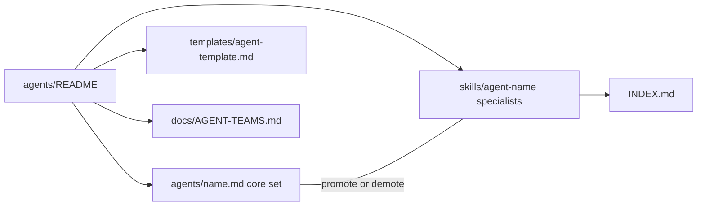

# Agents

Claude Code shows every agent's name and description to the main model in every session, so this folder holds only a small **core** set. All other specialists live as **agent skills** (`skills/agent-<name>/`): skills that run as their own subagent (`context: fork`) when invoked, listed by name only until then. Nothing was removed; see `INDEX.md` or the `toolkit-router` skill to find one.

Up: [README](../README.md) · Not here: agent skills (`agent-<name>`) are listed in [`skills/MASTER_INDEX.md`](../skills/MASTER_INDEX.md) and [`INDEX.md`](../INDEX.md); multi-session teams are in [AGENT-TEAMS.md](../docs/AGENT-TEAMS.md).

## Routes

| Need / keywords | Open | Notes |
| --- | --- | --- |
| core agent, review, debug, security, architecture, performance, refactor, React, TypeScript, iOS, DevOps | [Core agents](#core-agents-always-listed) below | Always listed to the main model |
| specialist agent, `agent-<name>`, language or domain expert | [`INDEX.md`](../INDEX.md), [`skills/MASTER_INDEX.md`](../skills/MASTER_INDEX.md) | Run as their own subagent when invoked |
| write a new agent | [`templates/agent-template.md`](../templates/agent-template.md) | |
| promote or demote an agent | [Changing the core set](#changing-the-core-set) below | |
| agent teams, parallel sessions | [AGENT-TEAMS.md](../docs/AGENT-TEAMS.md), [workflows/agent-teams.md](../docs/reference/workflows/agent-teams.md) | |

## Map

## Contents

### Core agents (always listed)

| Agent | Use for |
| --- | --- |
| [`deep-code-reviewer`](./deep-code-reviewer.md) | Thorough review of a change set |
| [`debugging-specialist`](./debugging-specialist.md) | Hard or intermittent bugs |
| [`security-auditor`](./security-auditor.md) | Security review, secrets, dependency risk |
| [`architecture-analyst`](./architecture-analyst.md) | Structure, boundaries, design trade-offs |
| [`performance-optimizer`](./performance-optimizer.md) | Profiling and speed work |
| [`refactoring-specialist`](./refactoring-specialist.md) | Large safe refactors |
| [`react-expert`](./react-expert.md) | React / frontend work |
| [`typescript-expert`](./typescript-expert.md) | TypeScript typing and patterns |
| [`ios-developer`](./ios-developer.md) | Swift / SwiftUI / Apple platforms |
| [`devops-engineer`](./devops-engineer.md) | CI/CD, infrastructure, deployment |

Core agents inherit the session's model (no per-agent model pins).

### Specialist agent skills (on demand)

58 more specialists (languages, frameworks, mobile, data/ML, design, business, product, and more) are invoked as `/agent-<name>` or by Claude through the Skill tool, e.g. `/agent-python-expert refactor the settings loader`. Each runs in its own subagent with the full original agent prompt.

## Changing the core set

Promote or demote by moving a file between `agents/<name>.md` and `skills/agent-<name>/SKILL.md` (the conversion is mechanical: same prompt body, `context: fork`, `agent: general-purpose`). The separately configured weekly tuning job can do this from real usage counts. Pre-commit runs safety gates only: no budget tests, generation or automatic staging. Review public source changes, then explicitly refresh the index and [count snapshot](../docs/COUNT-PIPELINE.md) when publication is authorized.
