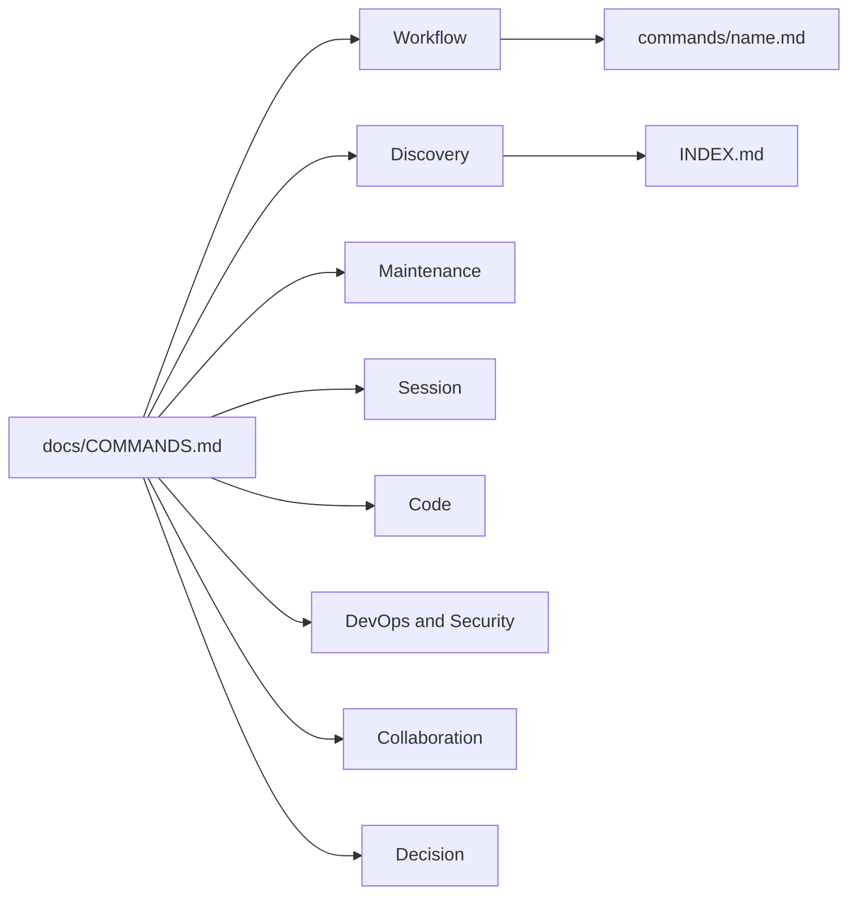

# Slash Commands Index

Slash commands are shortcuts you invoke in Claude Code with `/<command-name>`. They load structured prompts that guide Claude through specific workflows.

**Usage:** Type `/<command-name>` in Claude Code. Some commands accept arguments.

Up: [docs/README.md](./README.md) · Not here: `commands/` has no README on purpose, because every `.md` file there becomes a slash command; skills you can also call as `/name` are listed in [`INDEX.md`](../INDEX.md).

## Routes

| Need / keywords | Open | Notes |
| --- | --- | --- |
| route a task, run saved prompts | [Workflow](#workflow) | `start-task`, `run` |
| find a skill, browse skills, marketplace search | [Discovery](#discovery) | `skill-finder`, `list-skills`, `discover-skills` |
| diagnostics, backup, counts, docs refresh, changelog, pull repos, bootstrap | [Maintenance](#maintenance) | |
| handoff, session history, context usage | [Session](#session) | |
| code review, project init, CLAUDE.md, scaffold, test plan | [Code](#code) | |
| deploy, security scan, dependency updates, performance audit, migrations | [DevOps & Security](#devops--security) | |
| agent team | [Collaboration](#collaboration) | `assemble-team` |
| architecture decision log | [Decision](#decision) | `log-decision` |

## Map



---

## Contents

### Workflow

| Command       | Description                                                                                                 | Usage                                  |
| ------------- | ----------------------------------------------------------------------------------------------------------- | -------------------------------------- |
| [`start-task`](../commands/start-task.md)  | Universal intelligent router — routes any prompt to optimal resources from skills, agents, and marketplaces | `/start-task refactor the auth module` |
| [`run`](../commands/run.md)         | Execute prompt(s) from `./prompts/` with automatic archiving                                                | `/run 001` or `/run 5 6 7`             |

### Discovery

| Command           | Description                                                                                         | Usage                                               |
| ----------------- | --------------------------------------------------------------------------------------------------- | --------------------------------------------------- |
| [`skill-finder`](../commands/skill-finder.md)    | AI-powered skill recommendation based on problem description — searches local skills + marketplaces | `/skill-finder I need to optimize database queries` |
| [`list-skills`](../commands/list-skills.md)     | Browse available skills by domain or list all with categorization                                   | `/list-skills frontend`                             |
| [`discover-skills`](../commands/discover-skills.md) | Search skillsmp.com for Claude Code skills via public API                                           | `/discover-skills`                                  |

### Maintenance

| Command         | Description                                                             | Usage                   |
| --------------- | ----------------------------------------------------------------------- | ----------------------- |
| [`health-check`](../commands/health-check.md)  | Run diagnostics on toolkit configuration and status                     | `/health-check`         |
| [`backup-config`](../commands/backup-config.md) | Backup Claude Code configuration files                                  | `/backup-config create` |
| [`update-counts`](../commands/update-counts.md) | Explicit public-source snapshot refresh; committed marketplace HEAD evidence and numeric docs | `/update-counts` |
| [`update-docs`](../commands/update-docs.md)   | Scan for recently modified files and update corresponding documentation | `/update-docs`          |
| [`changelog`](../commands/changelog.md)     | Generate formatted changelog entry from git commits since last tag     | `/changelog v2.6.0`    |
| [`audit-docs`](../commands/audit-docs.md)    | Scan documentation for staleness — broken links, outdated counts       | `/audit-docs all`       |
| [`pull-repos`](../commands/pull-repos.md)    | Pull all repos (parent + marketplace clones)                        | `/pull-repos`           |
| [`bootstrap`](../commands/bootstrap.md)     | Verify and repair Claude Code Toolkit installation                      | `/bootstrap`            |

### Session

| Command         | Description                                               | Usage               |
| --------------- | --------------------------------------------------------- | ------------------- |
| [`handoff`](../commands/handoff.md)       | Create a handoff document for seamless session continuity | `/handoff`          |
| [`session-log`](../commands/session-log.md)   | Retired: explains where session history lives now (`--resume`, `/usage`) | `/session-log` |
| [`context-stats`](../commands/context-stats.md) | Display context window usage and token statistics         | `/context-stats`    |

### Code

| Command                 | Description                                                                                  | Usage                                             |
| ----------------------- | -------------------------------------------------------------------------------------------- | ------------------------------------------------- |
| [`review-code`](../commands/review-code.md)           | Comprehensive code review on recent changes or specified files                               | `/review-code staged` or `/review-code src/auth/` |
| [`init-project`](../commands/init-project.md)          | Initialize project with CLAUDE.md template — adaptive detection for new or existing projects | `/init-project react`                             |
| [`standardize-claude-md`](../commands/standardize-claude-md.md) | Add missing toolkit sections to existing CLAUDE.md                                           | `/standardize-claude-md`                          |
| [`scaffold`](../commands/scaffold.md)              | Scaffold project components from templates (API endpoint, component, service, middleware)     | `/scaffold api-endpoint users`                    |
| [`test-suite`](../commands/test-suite.md)            | Run tests, analyze failures, report coverage, suggest missing tests                          | `/test-suite`                                     |
| [`test-plan`](../commands/test-plan.md)             | Generate test strategy document — test matrix, coverage goals, test pyramid allocation       | `/test-plan auth-module`                          |

### DevOps & Security

| Command         | Description                                                                       | Usage                |
| --------------- | --------------------------------------------------------------------------------- | -------------------- |
| [`deploy`](../commands/deploy.md)        | Deploy application with pre/post-deploy checks to Vercel/AWS/Netlify/Docker       | `/deploy production` |
| [`security-scan`](../commands/security-scan.md) | Run OWASP checks, npm audit, secret scanning, dependency vulnerability analysis   | `/security-scan`     |
| [`deps-update`](../commands/deps-update.md)   | Audit dependencies for security advisories, breaking changes, and safe updates    | `/deps-update`       |
| [`perf-audit`](../commands/perf-audit.md)    | Performance audit — bundle size, render perf, API times, database queries         | `/perf-audit`        |
| [`migrate`](../commands/migrate.md)       | Generate and manage database migrations with validation and rollback strategies   | `/migrate`           |

### Collaboration

| Command         | Description                                                                   | Usage            |
| --------------- | ----------------------------------------------------------------------------- | ---------------- |
| [`assemble-team`](../commands/assemble-team.md) | Spawn an Agent Team with role-based teammates for parallel collaborative work | `/assemble-team` |

### Decision

| Command        | Description                                                     | Usage           |
| -------------- | --------------------------------------------------------------- | --------------- |
| [`log-decision`](../commands/log-decision.md) | Append an architectural decision to the persistent decision log | `/log-decision` |

---

## Quick Examples

```
# Start any task with intelligent routing
/start-task add JWT authentication to the API

# Find the right skill for a problem
/skill-finder I need to write E2E tests for a React app

# Review staged changes before committing
/review-code staged

# Create a session handoff before ending work
/handoff

# Check toolkit health
/health-check
```

---

## Related Documentation

- [CLAUDE.md](../CLAUDE.md) - Core rules (always loaded)
- [skills/README.md](../skills/README.md) - Skills overview
- [agents/README.md](../agents/README.md) - Agents directory
- [WORKFLOW-GUIDE.md](./WORKFLOW-GUIDE.md) - Workflow patterns
- [templates/command-template.md](../templates/command-template.md) - Starting point for a new command

---

_Base commands and router wrappers are separate populations in `counts.json`; this category guide is not the inventory. Type `/<name>` to invoke. See [Count pipeline](./COUNT-PIPELINE.md)._
