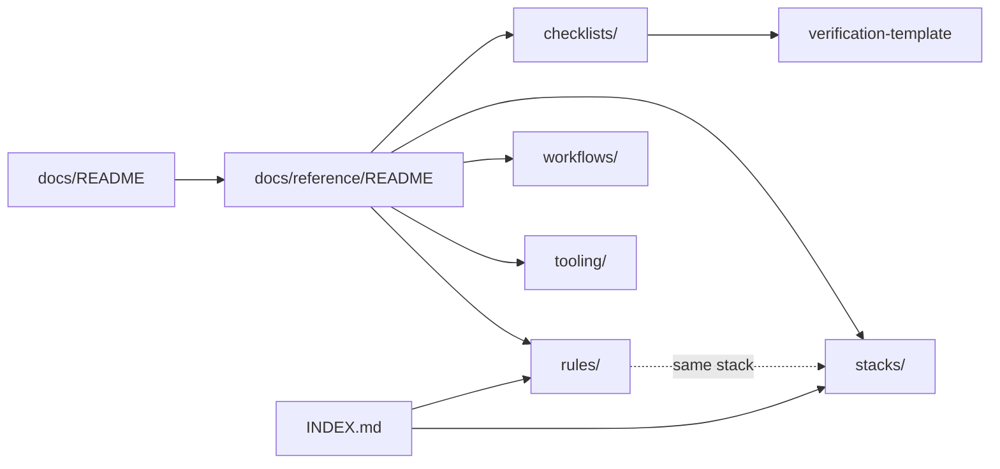

# Reference Docs and Rules

Front door for the path-scoped language rules in `rules/` and the on-demand reference docs in `docs/reference/` (stacks, checklists, workflows, tooling).
Up: [docs/README.md](../README.md) · Not here: skills, agents, and commands are found through the generated [`INDEX.md`](../../INDEX.md) or the `toolkit-router` skill; the private rule layer (`rules/local/`) is gitignored and documented in [local.example/README.md](../../local.example/README.md).

`rules/` and the four folders below have no README of their own on purpose: Claude Code loads every `.md` file in `rules/` as a rule, and the showcase website publishes every `.md` file in a `docs/reference/<folder>/` as a rule page. This page lists all of them instead.

## Routes

| Need / keywords | Open | Notes |
| --- | --- | --- |
| language rule, coding guardrail, TypeScript, Python, Go, Rust, Swift, Kotlin, C++, Dart, API routes, legal exposure | [Rules](#rules) below | Short, path-scoped: each loads only when Claude reads a matching file |
| stack guide, framework conventions, React, Next.js, NestJS, Vue, Nuxt, Svelte, Django, FastAPI, Expo, Flutter | [Stacks](#stacks) below | One guide per stack, read on demand |
| checklist, API, database, security, performance, monitoring, mobile release, static site, UI change, automation, verification | [Checklists](#checklists) below | Task checklists, read on demand |
| workflow, action policy, agent teams, context window, CI/CD, deploy, post-change docs, research method | [Workflows](#workflows) below | |
| tooling, external repos, marketplace updates, git hooks, MCP lifecycle, troubleshooting | [Tooling](#tooling) below | |
| how rules and reference docs are discovered | [`INDEX.md`](../../INDEX.md) (Rules, Reference docs sections) | Generated by `scripts/generate-index.mjs` |

## Map

## Contents

### Rules

Path-scoped files in [`rules/`](../../rules/); the `paths:` frontmatter of each decides when it loads.

- [api-routes.md](../../rules/api-routes.md) — REST conventions, boundary validation, auth middleware, rate limits
- [cpp.md](../../rules/cpp.md) — modern C++17+, RAII, CMake, safe C habits
- [flutter-dart.md](../../rules/flutter-dart.md) — Riverpod, const widgets, GoRouter, strong Dart typing
- [go.md](../../rules/go.md) — error wrapping, context cancellation, small interfaces
- [java-kotlin.md](../../rules/java-kotlin.md) — Kotlin null safety, Java records, Spring injection, coroutines
- [python.md](../../rules/python.md) — type hints, pathlib, async I/O, Django and FastAPI basics
- [rust.md](../../rules/rust.md) — borrowing, thiserror/anyhow, tokio, documented unsafe
- [swift-ios.md](../../rules/swift-ios.md) — SwiftUI state, Swift concurrency, typed throws, no force unwraps
- [typescript-react.md](../../rules/typescript-react.md) — strict types, `unknown` over `any`, functional React
- [web-legal-exposure.md](../../rules/web-legal-exposure.md) — self-hosted fonts, no session replay, email, subscription, age, DMCA

### Stacks

- [django-fastapi.md](./stacks/django-fastapi.md) — Django and FastAPI web applications
- [flutter-dart.md](./stacks/flutter-dart.md) — Flutter 3 and Dart 3 cross-platform apps
- [fullstack-nextjs-nestjs.md](./stacks/fullstack-nextjs-nestjs.md) — Next.js frontend with NestJS backend
- [go.md](./stacks/go.md) — Go APIs, CLIs, microservices, system tools
- [python.md](./stacks/python.md) — Python scripts, automation, APIs, data processing
- [react-native-expo.md](./stacks/react-native-expo.md) — React Native with Expo SDK 52+
- [react-typescript.md](./stacks/react-typescript.md) — React applications with TypeScript
- [rust.md](./stacks/rust.md) — Rust systems, CLIs, WebAssembly, performance work
- [svelte-sveltekit.md](./stacks/svelte-sveltekit.md) — Svelte 5 and SvelteKit web applications
- [vue-nuxt.md](./stacks/vue-nuxt.md) — Vue 3 and Nuxt 3 web applications

### Checklists

- [api-development.md](./checklists/api-development.md) — designing, building, reviewing REST or GraphQL APIs
- [automation-scripts.md](./checklists/automation-scripts.md) — scripts, batch processing, data transformation
- [database-design.md](./checklists/database-design.md) — schemas, migrations, query performance
- [mobile-app-deployment.md](./checklists/mobile-app-deployment.md) — App Store, Google Play, beta, OTA updates
- [monitoring-alerting-design.md](./checklists/monitoring-alerting-design.md) — SLOs, metrics, alerting, dashboards, tracing
- [performance-optimization.md](./checklists/performance-optimization.md) — Core Web Vitals, bundles, images, caching
- [security-hardening.md](./checklists/security-hardening.md) — security measures, vulnerability review, deployment hardening
- [static-sites.md](./checklists/static-sites.md) — HTML/CSS/JS sites without build tools
- [ui-visual-changes.md](./checklists/ui-visual-changes.md) — styling, animation, and other visual changes
- [verification-template.md](./checklists/verification-template.md) — confirm a finished task before calling it done

### Workflows

- [action-policy.md](./workflows/action-policy.md) — configuring how proactively Claude acts
- [agent-teams.md](./workflows/agent-teams.md) — single session vs subagents vs teams vs Workflows
- [context-management.md](./workflows/context-management.md) — context window, multi-window work, state persistence
- [deployment-cicd.md](./workflows/deployment-cicd.md) — CI/CD pipelines, deploy strategies, rollback
- [post-change-documentation.md](./workflows/post-change-documentation.md) — updating docs after any toolkit change
- [research-methodology.md](./workflows/research-methodology.md) — systematic research, analysis, synthesis

### Tooling

- [external-repos.md](./tooling/external-repos.md) — updating marketplace plugins and external dependencies
- [git-hooks-setup.md](./tooling/git-hooks-setup.md) — project automation through git hooks
- [mcp-servers.md](./tooling/mcp-servers.md) — when to enable or disable MCP servers
- [troubleshooting.md](./tooling/troubleshooting.md) — common workflow, hook, and tool issues
