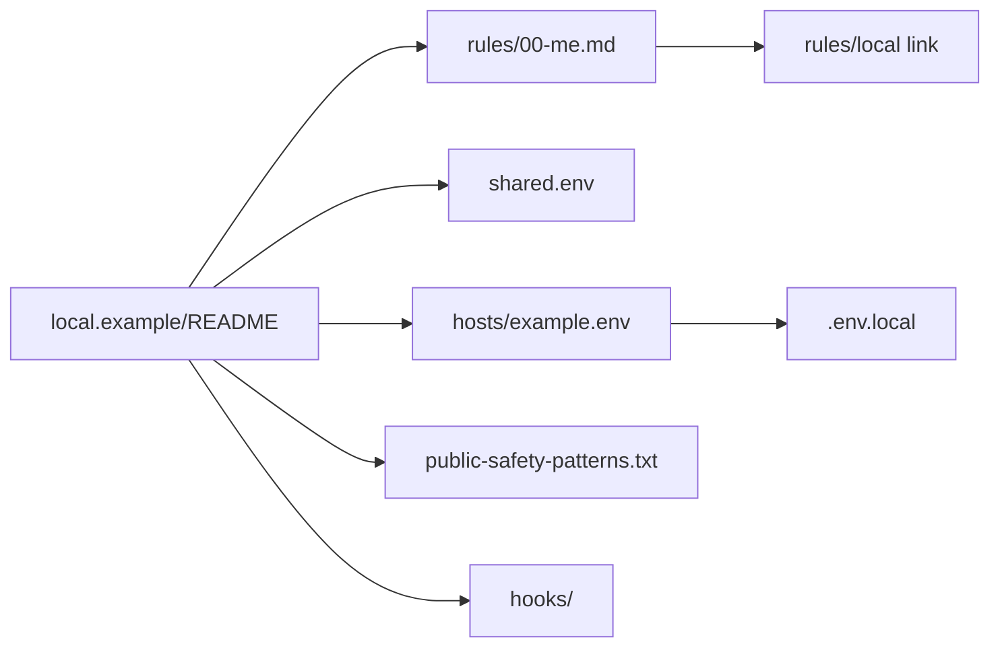

# `local/` — your private layer (template)

Everything personal or machine-specific goes in `~/.claude/local/`, which is gitignored. The public toolkit works without it; with it, you get your own rules, hooks, and settings on top.

Up: [README](../README.md) · Not here: public, shared rules are in `rules/` (listed in [docs/reference/README.md](../docs/reference/README.md#rules)); hook behavior is in [hooks/README.md](../hooks/README.md); gitignore and exposure policy is in [docs/SECURITY.md](../docs/SECURITY.md).

## Routes

| Need / keywords | Open | Notes |
| --- | --- | --- |
| private rule, about me, GitHub owner, git identity | [`rules/00-me.md`](./rules/00-me.md) | Loads in every session once linked as `rules/local` |
| settings for all machines, push owners, pull cadence, autopush | [`shared.env`](./shared.env) | Keys explained in [Settings](#settings-read-by-the-toolkit-hooks) below |
| per-machine settings, project dirs, push command | [`hosts/example.env`](./hosts/example.env) | Copy or link to `~/.claude/.env.local` |
| public-safety gate, private names that must never be committed | [`public-safety-patterns.txt`](./public-safety-patterns.txt) | Read by the pre-commit hook |
| private hooks | `local/hooks/` (create it; not shipped in the template) | `local-session-start.sh`, `local-pre-tool-use.py` |
| setup on a new machine | [Setup](#setup-on-a-machine) below | |

## Map



## Contents

```
~/.claude/local/
├── rules/                     # Private rules, auto-loaded: link ~/.claude/rules/local -> local/rules
├── hooks/
│   ├── local-session-start.sh # optional; runs at session start (dispatched by hooks/run-hook.js)
│   └── local-pre-tool-use.py  # optional; runs before Bash/EnterWorktree/Agent calls
├── shared.env                 # settings shared by all your machines
├── hosts/<HOST>.env           # per-machine settings; copy or link to ~/.claude/.env.local
└── public-safety-patterns.txt # regexes the public repo must never contain (pre-commit gate)
```

### Setup on a machine

```bash
cp -R ~/.claude/local.example ~/.claude/local      # or link a folder you back up elsewhere
ln -s ../local/rules ~/.claude/rules/local
cp ~/.claude/local/hosts/example.env ~/.claude/.env.local   # then edit
bash ~/.claude/scripts/setup-hooks.sh
```

Keep a backup of `local/` somewhere private (a private repo or notes vault). Git never sees it.

## Settings read by the toolkit hooks

| Key | Where | Effect |
| --- | --- | --- |
| `GITHUB_OWNERS` | `shared.env` | Comma list of GitHub owners whose repos the session-end hook may push. Unset = report only. |
| `PULL_INTERVAL_HOURS` | `shared.env` | Background pull cadence (default 24, `0` disables). |
| `PULL_CUSTOM_PROJECT_DIRS` | `shared.env` | `0` = don't pull your project repos, only `~/.claude` + marketplaces. |
| `SESSION_END_AUTOPUSH` | `shared.env` | `0` = never push at session end. |
| `CUSTOM_PROJECT_DIRS` | host file | Comma list of project roots for the repo-health banner and daily pull. |
| `REPO_PUSH_COMMAND` | host file | Push command run inside a repo instead of `git push`. |
